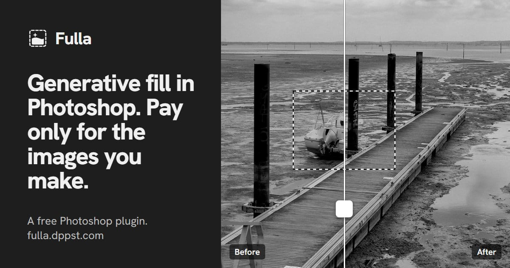

# Fulla

[](https://github.com/toorop/fulla/releases/latest)
[](https://github.com/toorop/fulla/actions/workflows/ci.yml)
[](LICENSE)
[](https://fulla.dppst.com)

**Generative fill in Photoshop. Pay only for the images you make.**

Fulla is a free Photoshop plugin. Select an area, say what you want, click Generate: just like Photoshop's own generative fill, with your own account at an AI service (OpenRouter, Google or OpenAI). From about 5 cents an image, no subscription, no credits.



**[Download](https://github.com/toorop/fulla/releases/latest)** · **[Website and docs](https://fulla.dppst.com)** · [Fulla vs Photoshop's generative fill](https://fulla.dppst.com/fulla-vs-photoshop-generative-fill/) · [Changelog](https://fulla.dppst.com/docs/changelog/)

## Why Fulla

- **Pay for what you make.** You pay the AI service per image; Fulla shows the cost in dollars after every run.
- **Sharp enough for print.** Up to 4K, chosen from the size of your selection.
- **Blends into your photo.** The whole photo goes along for context, and the colours of the result are matched to it.
- **Reference images.** Show the model the real pattern, face or object.
- **No server.** Fulla talks to the AI service you chose, directly. Your keys stay on your computer.
- **Free and open source**, MIT.

Models: Nano Banana 2.1 (recommended), Nano Banana Pro, GPT Image, Qwen Image, through OpenRouter (one account for all, a few clicks from the panel) or your own Google or OpenAI key. See [Models](https://fulla.dppst.com/docs/models/).

## Install

You need **Photoshop 2026 (27.11 or later)**.

**With the Creative Cloud app (Windows and macOS):** download `fulla-<version>.ccx` from [Releases](https://github.com/toorop/fulla/releases/latest) and double-click it. Creative Cloud warns that the plugin comes from a third-party developer; the first time, Windows may ask for administrator rights.

**Without the Creative Cloud app or administrator rights (Windows):** download `fulla-<version>-windows.zip`, unzip it, close Photoshop and double-click **Install Fulla.bat**. **Uninstall Fulla.bat** removes it again.

<details>
<summary>What the Windows installer changes</summary>

- Copies the plugin to `%APPDATA%\Adobe\UXP\Plugins\External\io.github.toorop.fulla`.
- Adds one entry to Photoshop's plugin list, `%APPDATA%\Adobe\UXP\PluginsInfo\v1\PS.json`, after saving a backup copy next to it. Other plugins are left untouched.
- **Uninstall Fulla.bat** removes both again.

</details>

Then open **Plugins > Fulla** and click **Connect with OpenRouter**, or add a Google or OpenAI key. The guide takes you from there: [First run](https://fulla.dppst.com/docs/first-run/), [Your first fill](https://fulla.dppst.com/docs/generative-fill/), [Troubleshooting](https://fulla.dppst.com/docs/troubleshooting/).

## Limits

More in [Limits](https://fulla.dppst.com/docs/limits/) on the website.

- The providers return at most about 4K pixels. Filling most of a large photo means upscaling, which looks softer; the panel tells you when that happens.
- The providers treat the mask as a guide, not a hard edge. Fulla clips their result to your selection.
- Cancel stops Fulla from using a result, but the provider may still bill the request it already received.
- Colours are right only when Photoshop keeps embedded profiles (see [Colours](https://fulla.dppst.com/docs/colours/)). A result that comes back as WebP gets no profile yet (PNG and JPEG do).
- The Windows installer is Windows only; on macOS use the `.ccx`.

## Develop

```bash
npm test          # unit tests, no dependencies
npm run package   # builds dist/fulla-<version>.ccx and -windows.zip
```

Load `plugin/manifest.json` in Adobe's UXP Developer Tools (turn on **Watch** to reload on every save), or install a dev copy with `installer/install.ps1 -Source plugin`; not both, they share the plugin id. UXP Developer Tools needs Photoshop's developer mode on (**Preferences > Plugins > Enable Developer Mode**), otherwise Load fails with "Failed to load the devtools plugin". To add a provider, write one file in `plugin/src/providers/` with the same shape as `openai.js` and list it in `providers/index.js`.

### Release

1. Set the same `version` in `package.json` and `plugin/manifest.json`.
2. Add a `## X.Y.Z` section, written for users, at the top of the website's Changelog page (`site/src/content/docs/docs/changelog.md`). It becomes the release notes; links such as `/docs/...` are turned into links to the website.
3. Commit and push, then push the tag:
   ```bash
   git tag vX.Y.Z && git push origin vX.Y.Z
   ```
4. `.github/workflows/release.yml` runs the whole CI, checks that the tag matches both versions and that the Changelog section exists, builds the `.ccx` and the Windows zip, adds `SHA256SUMS.txt`, and creates a **draft** release. Nothing is public yet.
5. On GitHub, read the draft, tick **Set as a pre-release** if wanted, and click **Publish release**.

If a step fails, no release is created. Fix the cause, move the tag (`git tag -d vX.Y.Z && git push origin :refs/tags/vX.Y.Z`, then step 3 again), or re-run the workflow if nothing needed fixing in the repository.

<details>
<summary>In-Photoshop self-test</summary>

Dev installs only; release packages leave it out. With the Fulla panel open, write `{}` to `selftest.json` in the plugin's data folder:

```
%APPDATA%\Adobe\UXP\PluginsStorage\<host>\<version>\<kind>\io.github.toorop.fulla\PluginData
```

`<host>` is `PHSP` (or `PHSPBETA` for the Photoshop beta) and `<kind>` is `Developer` when loaded from UXP Developer Tools, `External` when installed. It runs every scenario on throwaway documents with a stand-in AI provider and writes `selftest\result.json` plus PNG snapshots. Don't touch Photoshop while it runs. `{"only":["fill"]}` runs one scenario; `{"live":"openrouter"}` (or `openai`, `gemini`) runs two real, paid generations (a fill and a remove) with your saved key; add `"model":"qwen/qwen-image-3"` to try another model. The colour scenario (`adobeRgb`) fails if Photoshop's RGB colour policy is Off (see [Colours](https://fulla.dppst.com/docs/colours/)).

</details>

```
plugin/
├── manifest.json        # UXP manifest (id io.github.toorop.fulla)
├── index.html, main.js  # the panel
├── styles.css
├── icons/
└── src/
    ├── pipeline.js      # read, generate, place; host-free, tested with fakes
    ├── photoshop.js     # every Photoshop call
    ├── prompts.js       # the instruction sent to the model, with or without a prompt
    ├── settings.js      # keys (secure storage) and panel settings
    ├── menu.js, help.js # search in the floating menus; the ≡ menu's links
    ├── providers/       # one file per provider: openrouter.js, openai.js, gemini.js
    ├── connect.js       # OpenRouter connect (OAuth PKCE, headless), with sha256.js
    ├── cost.js          # estimated cost from the tokens each reply reports
    ├── image.js, png.js, geometry.js, bytes.js
    ├── icc.js           # sRGB profile embedded in results
    └── selftest.js      # in-Photoshop self-test, left out of release packages
installer/               # Install / Uninstall Fulla.bat and their PowerShell scripts
scripts/package.js       # builds the .ccx and the Windows zip
scripts/release-notes.js # release.yml: checks the tag, takes the notes from the Changelog page
test/                    # unit tests (Node's built-in runner)
docs/spec.md             # spec and test plan
```

## Contributing

Contributions are welcome: see [CONTRIBUTING.md](CONTRIBUTING.md). Security problems: [SECURITY.md](SECURITY.md).

## Credits and licence

Fulla is built on [OpenFill](https://github.com/damanjz/openfill) by Daman Reddy. [MIT](LICENSE).
